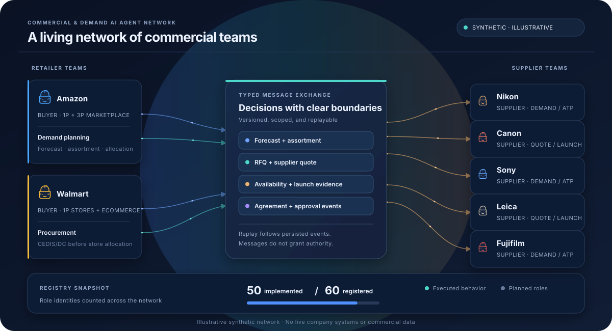
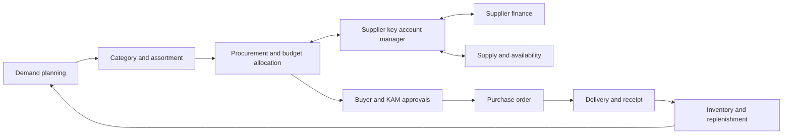
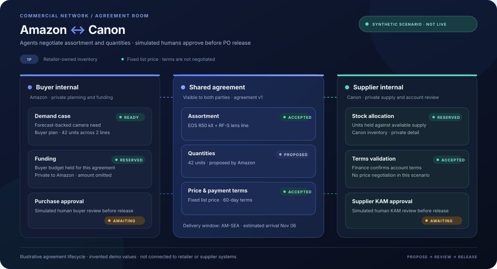
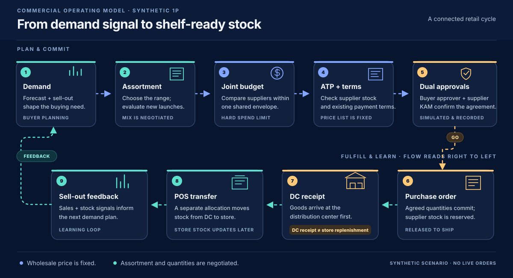

# Commercial & Demand AI Agent Network

### An enterprise commerce simulation by Ludovic Delot

**Demand → decisions → agreements → execution.** Explore how commercial teams coordinate through a shared, auditable agent network.

A portfolio case study exploring how specialized AI-agent roles can coordinate demand planning, procurement, inventory and commercial agreements across retailers and suppliers.

**This repository is a public showcase. The implementation is maintained privately.** All business scenarios and data are synthetic; the project is not affiliated with the companies used as examples. It does not place real orders or process payments.

## The problem

Buying teams must balance limited budgets, customer demand, existing inventory and supplier constraints. Brands need to meet sell-in targets and introduce new products, while retailers may refuse launches when similar products are not selling. These decisions involve several teams rather than one buyer and one seller.

## The approach

The simulation models Amazon and Walmart working with Nikon, Canon, Sony, Leica and Fujifilm. Each organization has specialized planning, commercial, finance and operations roles. Their typed messages and decisions are persisted, scoped to the relevant company, and connected to commercial outcomes.

## Product experience

- **Operations:** organization-specific views of procurement, stock, approvals, marketplace programs and settlement.
- **Agent Network:** simple and detailed maps of agent relationships and permitted data access.
- **Deal Rooms:** buyer–supplier agreements assembled from versioned building blocks, with playback of persisted events.
- **Retailer views:** Amazon fulfillment-center procurement and Walmart distribution-center-to-store replenishment.
- **Supplier views:** own-brand account activity, supply, authorized sell-out evidence and quota progress.

## A negotiation you can inspect

A supplier proposes a launch to support its commercial goals. The retailer checks related-line stock and sell-out before accepting a trial or refusing the launch. The regular assortment can still proceed, subject to available supply, budget and two approvals. Agreement playback shows how these decisions accumulate over time.

*The graphics are illustrative synthetic scenarios, not live screenshots or interactive controls.*

## From agreement to replenishment

Procurement acceptance, approval, delivery and customer availability are distinct events. This distinction matters especially for Walmart: goods received at a distribution center must still travel to stores before they can satisfy store demand.

## Commercial rules

- Retailer category margins and SKU wholesale prices are fixed in the modeled procurement flows; negotiation concerns quantities, assortment and feasible operational terms.
- Joint budget optimization compares opportunities across suppliers.
- A supplier quota does not force a retailer to purchase an unsuitable launch.
- A 1P purchase order requires both simulated buyer and supplier KAM approval of the same version.
- Seller-owned 3P inventory remains distinct from retailer-owned 1P stock.
- Receipt at Walmart's distribution center does not instantly replenish store inventory.
- Historical playback is read-only and cannot execute business actions.

## Current implementation snapshot

| Area | Verified scope |
|---|---|
| Organizations | 2 retailers and 5 camera brands |
| Agent roles | 60 registered; 50 implemented |
| Markets | United States, Germany and Spain |
| Currencies | USD and EUR with recorded synthetic FX |
| Internal coordination | Forecast, assortment, ATP, stock reservations, budget, delivery, Walmart replenishment and finance/KAM terms exchanges |
| Validation | 543 backend tests and 125 frontend tests passed at the showcase snapshot; production frontend build passed |

These figures describe an implementation snapshot, not a claim that the full roadmap is complete. Orchestrators, retailer returns roles and Walmart marketplace remain planned. Further work includes seller-team coordination, operational depth, scenario experiments and stronger command/message enforcement. Organization selectors currently simulate roles; they are not production authentication. Agent workflows are deterministic by default; live LLM and external enterprise integrations are not claimed as verified.

## Engineering

Python / FastAPI · Pydantic · SQLite company-scoped stores · React / TypeScript / Vite · integer optimization · event-based audit and replay.

The design emphasizes stock and budget conservation, repeat-safe commands, versioned approvals, scoped evidence and explicit planned-versus-implemented status.

## Explore the case study

- [Agent relationships](assets/network.svg) — specialized teams and typed exchanges.
- [Agreement building blocks](assets/deal-room.svg) — shared decisions and private team activity.
- [Commercial execution](assets/commerce-cycle.svg) — procurement through replenishment and sell-out.

The implementation focuses on a difficult coordination problem: making local team decisions reconcile with shared commercial outcomes. Its defining constraint is that a convincing conversation must still produce valid inventory, money and approval records.

## About this showcase

Only presentation material is included here. Application source, database snapshots, internal development documents, credentials and the private repository's Git history are intentionally absent. There is no hosted interactive demo in this repository.

**Author:** [Ludovic Delot](https://github.com/ludodelot)

## Why this project exists

Commercial planning is a coordination problem. A retailer can have enough total stock and still miss demand because the wrong SKU is in the wrong location. A supplier can meet an account's replenishment request while missing its own launch or sell-in objectives. A negotiated quantity can look attractive and still fail because inventory, funding, delivery or approval is unavailable.

This project explores an alternative to disconnected dashboards and informal handoffs: specialized agents representing the teams that actually make these decisions, with a shared record of what was requested, checked, agreed and executed.

## My role and project scope

I designed and developed the product concept, commercial simulation rules, agent-role model, organization views, agreement experience and validation strategy. AI coding assistants supported implementation and review in scoped work packages. The project combines commercial domain modeling with software engineering and interaction design.

This is an independent portfolio project. The retailer and brand names provide recognizable examples; all inventory, demand, prices, terms, quotas, transactions and operating assumptions are synthetic. None of the named companies supplied data or endorsed the project.

## Who the agents represent

| Organization | Commercial context | Responsibilities represented |
|---|---|---|
| Amazon | Ecommerce retail and seller-owned marketplace programs | Demand, assortment, 1P procurement, marketplace operations, fulfillment-center inventory, logistics and finance |
| Walmart | Ecommerce plus physical retail | Demand, assortment, procurement, distribution-center inbound, POS replenishment, availability promises, ecommerce fulfillment and finance |
| Nikon, Canon, Sony, Leica and Fujifilm | Wholesale suppliers and marketplace sellers | Key account management, supply/ATP, demand and sell-out evidence, quota/launch planning, seller operations, finance and logistics |

There are **60 registered role identities and 50 implemented roles** at the current snapshot. Registered does not mean executing: the interface distinguishes planned roles from implemented behavior. Seven company orchestrators, two retailer returns roles and Walmart marketplace remain planned.

## A concrete commercial scenario

Consider an illustrative Canon–Amazon negotiation:

1. Amazon's demand team prepares forecast and related-line evidence. Category decides which launches are suitable for the assortment.
2. Procurement receives those decisions and opens requests across the supplier portfolio.
3. Canon's demand and quota/launch roles prepare a new-product proposal. The KAM requests current availability from supply before quoting.
4. Amazon can decline that novelty because similar products already have aging stock or weak sell-out. A supplier's commercial target does not override that evidence.
5. The joint buying plan allocates the available budget across feasible products and suppliers, rather than approving each negotiation in isolation.
6. The KAM requests finance validation of account terms. Funding, stock reservations and a feasible delivery lane support the proposed order.
7. Both the retailer purchase approver and the supplier KAM approver must approve the same PO version. These are simulated human approval roles.
8. Dispatch, receipt, invoicing and subsequent customer sales create separate operational records.

This is a scenario illustration of the implemented mechanisms, not a real company transaction or a measured business outcome.

## Two different retail operating models

### Amazon: fulfillment centers and ownership

The 1P flow purchases wholesale inventory into retailer fulfillment centers. Seller-owned 3P programs use separate ownership, listings, inventory and settlement concepts. Customer sales, platform fees and supplier sell-in are not interchangeable measures.

The US and European scenarios distinguish operating entities, destinations and currencies. Germany and Spain are separate markets; consolidated monetary views name the synthetic FX basis rather than adding EUR and USD directly.

### Walmart: distribution center before store

Walmart models physical-store and ecommerce demand. Replenishment evaluates distribution-center stock first, then open inbound coverage, and only then the residual purchase requirement at location/SKU level.

The replenishment role requests an inbound status from the CEDIS role and sends residual need to procurement. Store transfers reserve and move inventory through their own lifecycle. Receipt at CEDIS does not instantly make that inventory available at a POS.

### Suppliers: account demand and commercial objectives

A brand has its own inventory constraints, account history, authorized own-brand sell-out and sell-in target. Its demand role supplies evidence to quota/launch planning; the KAM consumes the resulting proposal and requests ATP before quoting.

Quota progress distinguishes booked, shipped and invoiced measures. Marketplace seller activity is tracked separately from wholesale sell-in. The broader strategies for reacting to quota gaps and comparing negotiation policies remain an area of planned development.

## Negotiation dimensions and boundaries

| Dimension | What the simulation considers |
|---|---|
| Assortment | Which SKUs belong in the order and which are excluded |
| Quantity | Funded units subject to demand, ATP, allocation caps, MOQ and case packs |
| Launch inclusion | Trial or refusal using related-line stock and sell-out evidence |
| Funding | Available retailer budget and recorded commitments |
| Allocation | Held inventory supporting the agreed quantity |
| Delivery | Feasible lanes, processing time and delivery dates |
| Payment terms | Validated account terms passed from finance through the KAM |
| Approvals | Buyer and supplier approval of the same document version |

The procurement model uses fixed wholesale SKU prices and fixed synthetic retailer category margins. It does not simulate price-discount bargaining. Broader dynamic negotiation strategies and production/capacity negotiation are planned rather than implied by these dimensions.

## The three product views

**Operations** brings together role-specific procurement, inventory, approval and settlement views. The operator can examine Amazon, Walmart or a brand without pretending they all have the same operating model.

**Agent Network** shows relationships between organizations and roles. Its detailed view adds logical data products and permitted access so the user can inspect which agent is allowed to use which information. Observed activity is distinct from a configured permission edge.

**Deal Rooms** organize each buyer–supplier relationship into versioned agreement blocks. Internal buyer and supplier activity is separated from the shared agreement. Playback advances through stored events; it does not rerun a negotiation or mutate inventory and money. Quantity revisions invalidate the relevant prior approvals and require a coherent new version.

## Measures and decision evidence

The product connects commercial measures to underlying records rather than treating every dashboard number as an isolated total.

| Measure or evidence | Business interpretation |
|---|---|
| Fill rate and fulfilled demand | Whether customer demand is served; separate from supplier shipment completion |
| Stock coverage and aging | Whether existing stock justifies replenishment or argues against a similar launch |
| Budget and commitments | How much purchasing capacity is available and already reserved |
| Supplier sell-in and quota progress | Commercial progress on its stated recognition basis |
| Booked / shipped / invoiced units | Different stages of the supplier commercial lifecycle |
| Receipts and store transfers | Whether purchased stock has arrived and reached the right location |
| Payables, receivables and settlement | Financial consequences of execution |
| 3P GMV, fees and seller activity | Marketplace measures that must remain distinct from wholesale purchases |

Metric availability depends on the viewer and supported workflow. The project does not claim measured improvements in a real retailer's sales, margin or working capital. Forecast accuracy, policy-comparison confidence intervals and advanced working-capital analytics belong to later roadmap stages.

## Conceptual architecture

The private implementation combines a deterministic commercial simulation, constrained budget optimization, company-scoped storage, typed agent messages, versioned documents and an event record used for audit and replay. A browser interface exposes operational, network and agreement views.

Company boundaries matter: a supplier should see its own account evidence rather than another brand's costs or a retailer's private funding history. Internal message content remains scoped while shared decisions carry the information needed by the counterparty.

The role selector is a simulation convenience, not production authentication. The existing read-policy checks and scoped views do not imply that all production security controls are complete; stronger command/message enforcement remains planned. Optional language-model behavior is not allowed to authorize stock or money movements, and live LLM/enterprise integrations are not presented as verified.

## Engineering decisions and trade-offs

- **Specialist roles over one universal agent:** makes responsibility and data access inspectable, at the cost of more explicit coordination.
- **Typed exchanges over unconstrained chat:** messages must be valid inputs to actual workflows; fluent text alone cannot create a purchase.
- **Deterministic rules and optimization:** keep results reproducible and budgets/stock bounded while leaving room for later strategy experiments.
- **Versioned approvals:** a changed quantity cannot silently reuse approval of a previous order.
- **Explicit ownership:** retailer stock, supplier stock and seller-owned marketplace custody stay distinct.
- **Persisted-event playback:** the explanatory experience reconstructs what happened rather than generating a different story on demand.
- **Incremental implementation status:** planned features remain visible as planned until executable behavior and evidence exist.

## How the project is validated

At the published implementation snapshot, **543 backend tests and 125 frontend tests passed**, and the frontend production build passed. These are engineering checks, not proof of production readiness or real business impact.

Coverage includes commercial scenarios, stock and money invariants, scoped data access, command retries, approval versions, migrations, historical replay and failures in required agent exchanges. A focused matrix exercises all five suppliers through Amazon US and Walmart US 1P approvals, receipt, invoice equality and inventory reconciliation net of customer sales.

Finance/KAM tests verify that the accepted response supplies the PO's payment days, a rejected response is attributed through the KAM, and missing, mismatched or wrong-company inputs do not produce a partial PO. Independent frontend replay checks compare stored-event checkpoints with backend-generated expected states.

## Roadmap toward the final simulator

1. Finish seller 3P ATP/reservation coordination and remaining command/message enforcement.
2. Add executable orchestrators, operational depth, partial fulfillment, returns and quarantine; implement Walmart marketplace with its own supported scenarios.
3. Build a scenario lab with shocks, reproducible experiments and policy comparisons.
4. Deepen forecasting, negotiation strategies, multi-echelon logistics and working-capital analysis.
5. Add operator takeover, richer causal explanations, exportable reports and final accessibility/performance validation.

The intended end state is a complete synthetic demonstration with **60 genuinely implemented roles**, reproducible scenarios and reconciled commercial outcomes. Production deployment with real data and external transactions is a separate scope.

## What this portfolio demonstrates

Commercial systems thinking; translation of organizational processes into software; inventory and finance lifecycle modeling; constrained optimization; auditable agent coordination; scoped data design; interactive explanation through event playback; and evidence-based delivery with explicit implementation limits.

## Source availability

This public repository contains only the case study and presentation assets. It does not provide application source, executable backend logic, database extracts, internal development contracts, credentials or private repository history. The diagrams communicate the design without exposing the implementation.
