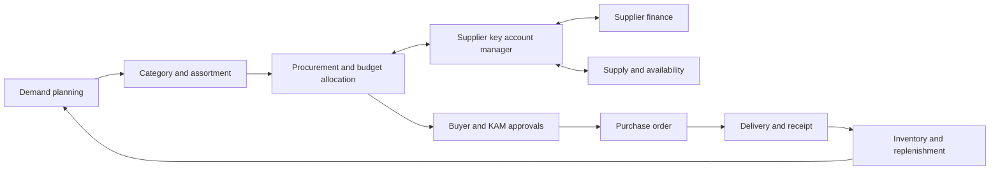

# Commercial & Demand AI Agent Network

### An enterprise commerce simulation by Ludovic Delot

A portfolio case study exploring how specialized AI-agent roles can coordinate demand planning, procurement, inventory and commercial agreements across retailers and suppliers.

**This repository is a public showcase. The implementation is maintained privately.** All business scenarios and data are synthetic; the project is not affiliated with the companies used as examples. It does not place real orders or process payments.

## The problem

Buying teams must balance limited budgets, customer demand, existing inventory and supplier constraints. Brands need to meet sell-in targets and introduce new products, while retailers may refuse launches when similar products are not selling. These decisions involve several teams rather than one buyer and one seller.

## The approach

The simulation models Amazon and Walmart working with Nikon, Canon, Sony, Leica and Fujifilm. Each organization has specialized planning, commercial, finance and operations roles. Their typed messages and decisions are persisted, scoped to the relevant company, and connected to commercial outcomes.

## Product experience

- **Operations:** organization-specific views of procurement, stock, approvals, marketplace programs and settlement.
- **Agent Network:** simple and detailed maps of agent relationships and permitted data access.
- **Deal Rooms:** buyer–supplier agreements assembled from versioned building blocks, with playback of persisted events.
- **Retailer views:** Amazon fulfillment-center procurement and Walmart distribution-center-to-store replenishment.
- **Supplier views:** own-brand account activity, supply, authorized sell-out evidence and quota progress.

## Commercial rules

- Retailer category margins and SKU wholesale prices are fixed in the modeled procurement flows; negotiation concerns quantities, assortment and feasible operational terms.
- Joint budget optimization compares opportunities across suppliers.
- A supplier quota does not force a retailer to purchase an unsuitable launch.
- A 1P purchase order requires both simulated buyer and supplier KAM approval of the same version.
- Seller-owned 3P inventory remains distinct from retailer-owned 1P stock.
- Receipt at Walmart's distribution center does not instantly replenish store inventory.
- Historical playback is read-only and cannot execute business actions.

## Current implementation snapshot

| Area | Verified scope |
|---|---|
| Organizations | 2 retailers and 5 camera brands |
| Agent roles | 60 registered; 50 implemented |
| Markets | United States, Germany and Spain |
| Currencies | USD and EUR with recorded synthetic FX |
| Internal coordination | Forecast, assortment, ATP, stock reservations, budget, delivery, Walmart replenishment and finance/KAM terms exchanges |
| Validation | 543 backend tests and 125 frontend tests passed at the showcase snapshot; production frontend build passed |

These figures describe an implementation snapshot, not a claim that the full roadmap is complete. Orchestrators, retailer returns roles and Walmart marketplace remain planned. Further work includes seller-team coordination, operational depth, scenario experiments and stronger command/message enforcement. Organization selectors currently simulate roles; they are not production authentication. Agent workflows are deterministic by default; live LLM and external enterprise integrations are not claimed as verified.

## Engineering

Python / FastAPI · Pydantic · SQLite company-scoped stores · React / TypeScript / Vite · integer optimization · event-based audit and replay.

The design emphasizes stock and budget conservation, repeat-safe commands, versioned approvals, scoped evidence and explicit planned-versus-implemented status.

## About this showcase

Only presentation material is included here. Application source, database snapshots, internal development documents, credentials and the private repository's Git history are intentionally absent. There is no hosted interactive demo in this repository.

**Author:** [Ludovic Delot](https://github.com/ludodelot)
